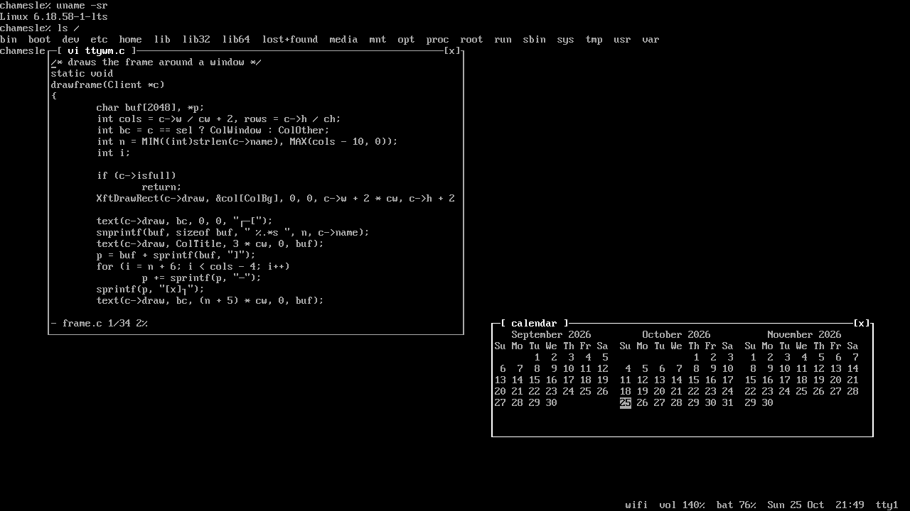
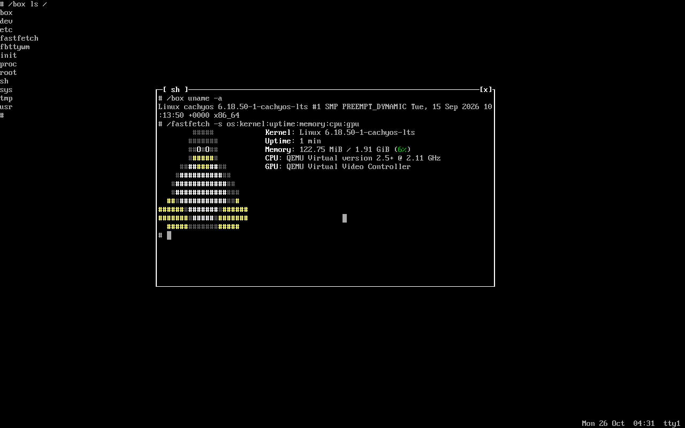

ttywm ,a window manager that looks like a tty
==============================================

Every screen is a full screen shell, in the console's own font and colours.
Windows float on top of it in frames drawn with that font:

	┌─[ firefox ]──────────────[x]┐
	│                             │
	└─────────────────────────────┘

The bottom line shows the network, volume, battery, date, time and which tty
you're on. Click the volume to mute, scroll on it to change it, click the
network to set up wifi.

X11 only, one C file, needs libX11, libXft, libdbus, pam, xterm, and rofi for the apps menu.

Install
-------
	make
	sudo make install

or on Chamesle Linux:

	sudo apk add ttywm

then pick ttywm on your login screen, or put this in ~/.xinitrc and run startx:

	exec ttywm-session

Settings
--------
Everything is in ~/.config/ttywm/config, made the first time ttywm starts.
It's plain words, like

	window colour = light green
	battery = off
	super+w = firefox

Change a line and save: ttywm picks it up straight away.

Keys
----
	Super+Return        terminal
	Super+d             apps menu
	Super+q             close window
	Super+Tab           next window, then the shell
	Super+f             full screen
	Super+1..9          go to tty1..tty9
	Super+Shift+1..9    send window to that tty
	Super+Shift+e       log out
	Super+Left/Right    half the screen
	Super+Up            all of it
	Super+Down          back where it was
	Super+l             lock the screen
	Super+drag          move
	Super+right drag    resize
	volume keys         volume
	brightness keys     brightness

Click [x] to close, drag the title to move, drag the bottom right corner to
resize, click the shell to type in it. Exit the shell and you get a new one.

Notifications show up in the top right corner, in a frame like the windows.
Click one to close it. If another program already shows notifications, like
dunst, ttywm leaves them to it.

The lock screen is a login prompt. Your password unlocks it.

fbttywm
-------

ttywm without X. It draws straight on the framebuffer in the console's own
font, reads the keyboard and mouse itself, and every window is one of its own
terminals. One C file, no libraries.

	make fbttywm
	sudo make install-fb

or on Chamesle Linux:

	sudo apk add fbttywm

Log in on a text console and run fbttywm. Your user needs to be in the video
and input groups. Same keys as ttywm, minus the apps menu and volume.
Super+Shift+e quits.

It's also what Chamesle Source ships as its desktop, as source you have to
compile yourself: https://github.com/tortr-rs/chamesle-source

## cheers @tortr-rs

